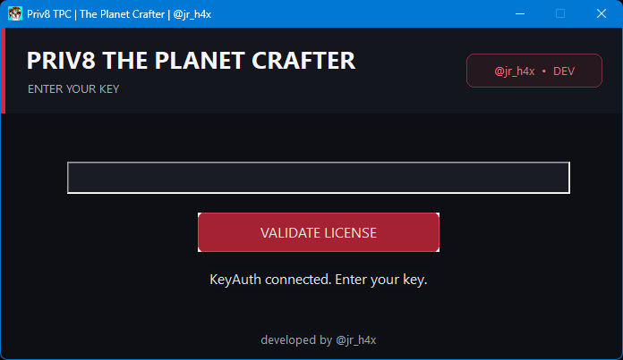
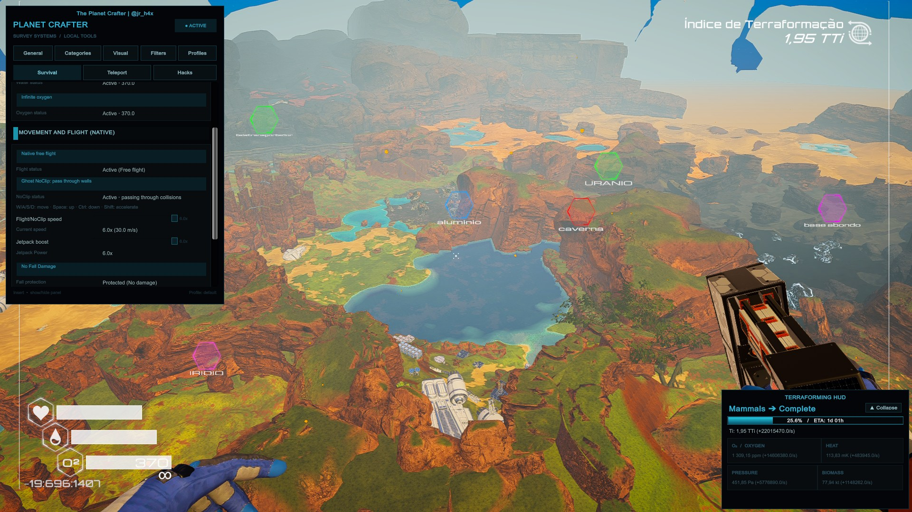
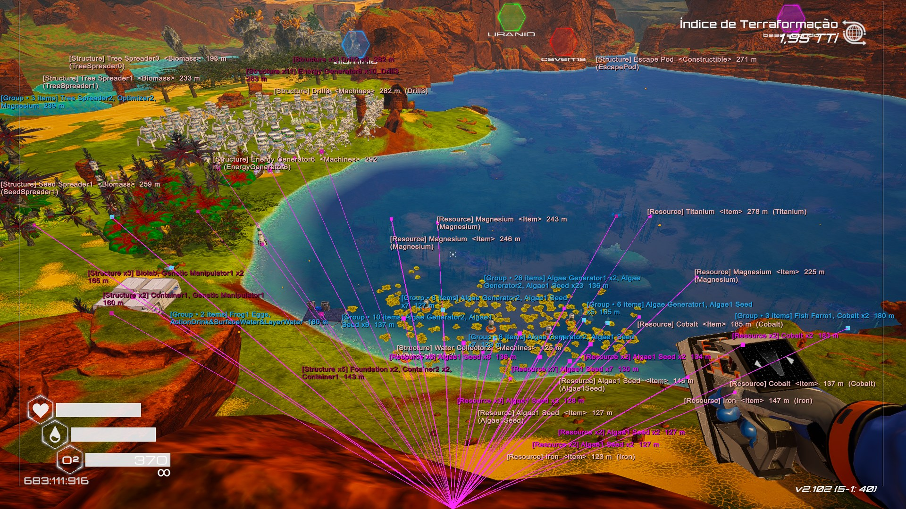

  

<h1 align="center">PRIV8 — The Planet Crafter</h1>

  <strong>Advanced Gameplay Customization & Visual Survey System</strong>

PRIV8 is a dedicated tool for The Planet Crafter, featuring a secure standalone loader and a feature-rich in-game overlay menu with comprehensive ESP, survival modifications, navigation tools, and terraforming diagnostics.

## Features

- **Full World ESP & Object Scanner**
  - Track **Resources**, **Structures & Machines**, **Interactive Objects**, **Rare Larvae & Butterflies**, and **Space Fuses (Endgame)**.
  - Inspect **linked container inventories** and chests directly through walls.
  - Bounding boxes, snaplines, distance indicators, position markers, and technical IDs.
  - Intelligent nearby item clustering with radius control and anti-overlap label stacking.
  - Complete checklist search filters and whitelist support.
  - Customizable color palettes, line thickness, marker size, opacity, and custom fonts.

- **Survival & Attributes**
  - **Infinite Health**
  - **Infinite Oxygen**
  - **Infinite Water (Thirst)**
  - **No Fall Damage**

- **Movement & Flight**
  - **Native Free Flight** (`FlyMode`)
  - **Ghost NoClip** (glide through terrain, bases, and shipwrecks with full 6-axis control)
  - **Speed Multiplier** (customizable locomotion & flight speed up to 6.0x)
  - **Jetpack Boost** (enhanced thrust factor)

- **Floating Terraforming HUD**
  - Real-time floating overlay with current and target terraformation stages.
  - Live Ti progress bar with stage completion percentage and dynamic **ETA calculation**.
  - Rate monitors for **O₂ (Oxygen)**, **Heat**, **Pressure**, and **Biomass**.
  - Compact and expanded view modes.

- **Item Vacuum / Magnet**
  - Automatically attracts and pulls loose resources and dropped items directly to the player.
  - Configurable attraction radius, pulse speed, and selective item whitelist filter.

- **Teleportation Suite**
  - **Aim Teleport**: Point crosshair at any surface and teleport instantly.
  - **Smart Teleport**: Automatically locate and teleport to the nearest selected item or resource in range.
  - **Coordinate Teleport**: Enter explicit X, Y, Z coordinates or capture current position.
  - **Saved Locations**: Save, rename, cycle, and teleport between custom waypoints.

- **Configuration Profiles**
  - Save, load, and restore `.ini` configuration profiles.
  - Rebindable hotkeys for menu toggle (default: `Insert`) and aim teleport (default: `F7`).

## Screenshots

### Loader

### In-Game Control Panel

### In-Game ESP & Gameplay

## Access & Authentication

A valid authentication key is required to access PRIV8.

Free access keys are available at:

**https://phsldev.eu.org/**

## Compatibility

Designed for **The Planet Crafter** (Steam x64, Unity Mono runtime).

## Developer

**jrh4x** &nbsp;

## Download

  <a href="https://github.com/jrh4x/priv8-the-planet-crafter-loader/raw/refs/heads/main/Priv8%20-%20The%20Planet%20Crafter.exe">
    <strong>DOWNLOAD PRIV8</strong>
  </a>

---

*PRIV8 is an independent community project. It is not affiliated with, endorsed by, or sponsored by Miju Games.*